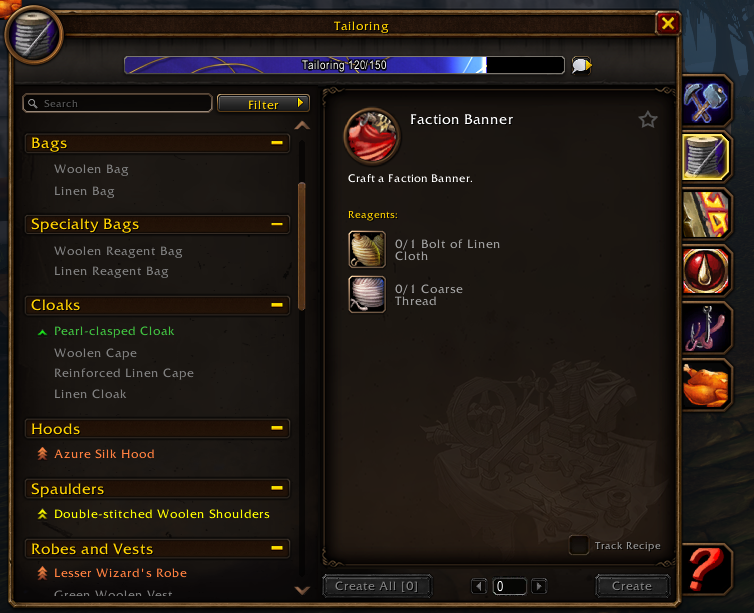

# CraftColors

WoW Forever (interface 16001). Colors recipe names in the profession window by skill-up difficulty: orange, yellow, green, gray.

- `/craftcolors` prints the difficulty data for the selected recipe (debugging).
- `/craftcolors feedback` shows a link for reporting bugs and ideas.

## Install
WowUp: pick **World of Warcraft: Forever**, then Get Addons → Install from URL, and paste `https://github.com/quikmn/CraftColors`.

By hand: download the latest zip from Releases and unzip it into `World of Warcraft\_forever_\Interface\AddOns`.

## License

GPL-3.0-or-later (see LICENSE). Not affiliated with Blizzard Entertainment.
