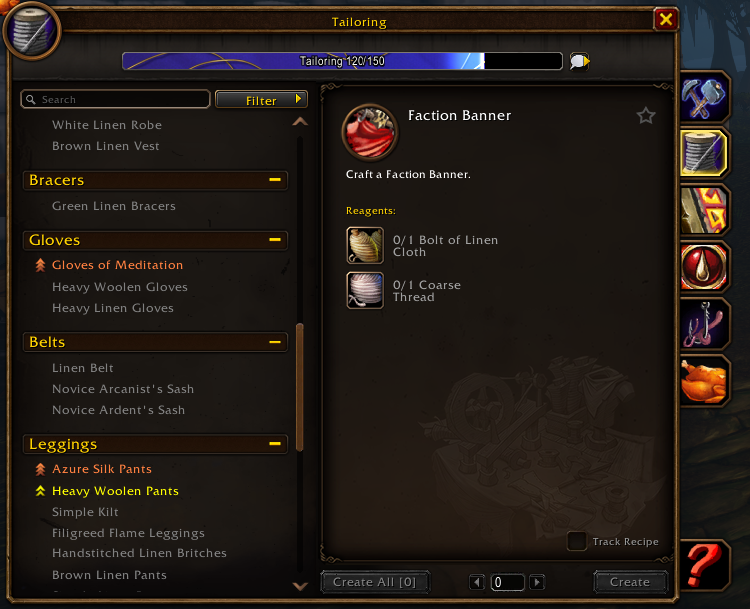
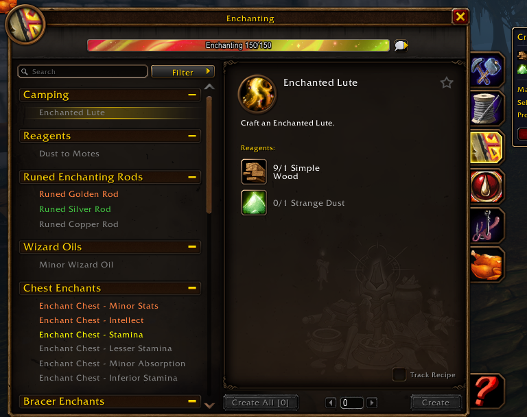

# CraftColors

WoW Forever (interface 16001). Colors recipe names in the profession window by skill-up difficulty: orange, yellow, green, gray.

## Commands

`/ccolors` (also `/craftcolors`) follows the same pattern as every EverlookDB addon:

- `/ccolors` opens the settings window: colouring on or off, your own colour for each difficulty, how much the row under the mouse brightens. It's also under Settings > AddOns.
- `/ccolors off`, `/ccolors on` (or `toggle`): the colouring.
- `/ccolors orange ff8040` (or `yellow`, `green`, `gray`, `hover 0.3`), or `/ccolors set orange ff8040`: change a setting; `/ccolors get` lists them.
- `/ccolors check` prints what the game says about the selected recipe (handy for bug reports).
- `/ccolors reset` puts the colours back (type it twice within 10 seconds).
- `/ccolors search <words>` opens the window with its search box filled; `/ccolors status`, `/ccolors version`.
- `/ccolors feedback` shows a link for reporting bugs and ideas. `/ccolors help` (or `?`) lists every command; a mistyped one suggests the nearest.

## Install
WowUp: pick **World of Warcraft: Forever**, then Get Addons → Install from URL, and paste `https://github.com/quikmn/CraftColors`.

By hand: download the latest zip from Releases and unzip it into `World of Warcraft\_forever_\Interface\AddOns`.

## License

GPL-3.0-or-later (see LICENSE). Not affiliated with Blizzard Entertainment.
